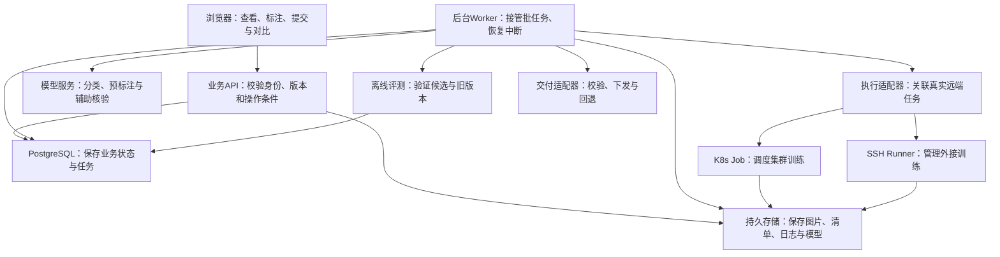
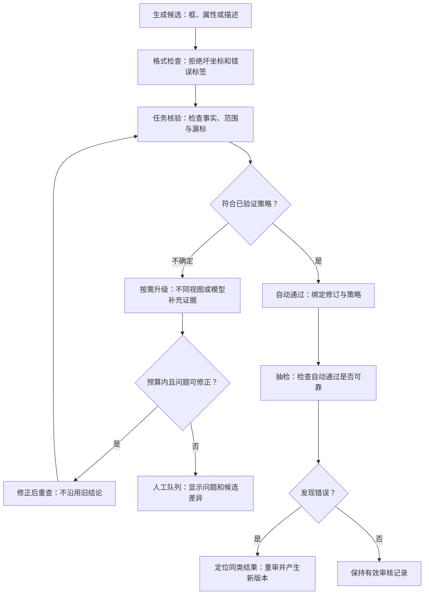

# 数据管理与模型生产线：实现方案 v0.1

日期：2026-09-30  
依据：[需求梳理 v0.3](../requirements/数据管理平台_需求梳理_v0.3.md)，共75条需求。  
状态：供技术评审与开发拆分使用的实现草案。本文提出建议方案，没有实施部署、访问内网服务器或运行模型训练。框架能力已查阅公开官方资料，具体版本和硬件兼容性需在开发前验证。

## 阅读导航

| 想了解什么 | 章节 |
|---|---|
| 整个平台怎样组成、用什么技术 | 1—2 |
| 页面有哪些功能、用户怎样操作 | 3 |
| 数据、标注、模型和版本怎样保存 | 4 |
| 导入、分类、质量筛选、去重怎样实现 | 5 |
| 如何自动打标、自动审核、减少人工 | 6 |
| 如何复用数据、导出、直接交付训练服务器 | 7 |
| 如何接入YOLO、图片描述、向量模型、DINOv3训练 | 8 |
| 如何调度算力、查看进度、取消和恢复任务 | 9 |
| 如何测试模型、回归验证和选择下一批数据 | 10 |
| 如何下发与回退 | 11 |
| 如何实现多租户与SSH调试 | 12 |
| 接口、运行维护、开发顺序和验收 | 13—15 |
| 需求覆盖与待定决策 | 16—17 |

## 1. 实现范围与前提

### 1.1 已确定的业务边界

1. 公司内部使用，最初约两名用户；已新增多租户。
2. 暂以全平台最多20万张原图、每算法约1万张作为容量设计基线；每租户是否也达到该规模尚未确认。
3. YOLO检测、大模型图片描述、向量模型图片描述是三条独立生产线；可以共享原图，标注、训练数据和模型版本分别保存。
4. 支持整图描述，也支持检测框切图后描述；支持DINOv3无标注训练和百张内下游微调。
5. 自动生成与自动审核优先；通过任务规则的结果可进入训练集，疑难、分歧和抽检样本才交给人工。
6. 从平台启动训练，保存进度、日志、指标和产物；接入外部算力及K8s，支持资源释放和SSH调试。
7. 生产交付包含模型及其必要配置，平台终点为下发与回退。生成的向量和检索索引仅用于测试。

### 1.2 本文采用的实现假设

| 事项 | 本文建议或假设 | 验证方式 |
|---|---|---|
| 部署环境 | 业务服务部署在公司内网Linux服务器；开发人员可使用Windows | 确认实际服务器、系统和运维方式 |
| 身份与租户 | 采用内部账号或已有登录系统；用户可属于一个或多个租户 | 确认账号来源和租户定义 |
| 业务并发 | 少量同时浏览、标注的用户；批任务主要受算力限制 | 用实际用户数与任务数压测 |
| 模型服务 | Qwen、Embedding、rerank及DeepSeek通过已部署HTTP服务或受控推理容器接入 | 分别验证图像输入、输出格式、批量和版本识别 |
| 训练环境 | 训练脚本在独立容器中运行，声明加速器、驱动及框架版本 | 先做单节点最小训练与模型加载验证 |
| 文件保存 | 优先使用公司已有持久存储；没有时先用独立数据盘，跨节点通过下载到本地缓存访问 | 验证读写、断线、校验及恢复 |
| 可用性 | 首版允许业务服务维护窗口；远端已启动训练不依赖浏览器常开 | 验证后端重启后任务重新关联 |
| 维护责任 | 平台代码与模型适配器有指定维护者，算力和存储由对应管理员维护 | 确认负责人和交接材料 |

响应时间、训练耗时、自动审核误差、备份恢复时间、人工介入比例等不在本文中当作已确认承诺。第14节提供可测量的方式，第17节列出必须定稿的参数。

## 2. 总体组成与技术建议

### 2.1 方案选择

| 方案 | 特点 | 对本项目的判断 |
|---|---|---|
| 一个业务后端＋独立任务进程＋训练执行节点 | 数据事务集中、部署组件少；模型和训练环境仍独立 | 建议首版采用 |
| 多个业务微服务＋消息中间件＋独立工作流平台 | 可以按团队独立扩展，但增加部署、排障与数据一致性成本 | 现有规模没有足够理由首版采用 |

长任务由独立进程和远端执行节点运行，Web接口负责提交和查询。FastAPI的后台任务文档也将重计算列为需要考虑独立执行工具的场景；本文的持久任务表与执行流程属于本平台设计。[FastAPI官方说明](https://fastapi.tiangolo.com/tutorial/background-tasks/)

### 2.2 建议技术组合

| 部分 | 建议 | 使用范围 |
|---|---|---|
| 前端 | Vue 3＋TypeScript＋Element Plus | 列表、筛选、任务、版本与报表页面；具体版本开发时锁定 |
| 图像编辑 | Canvas图层，优先使用成熟的Konva类库 | 画框、拖动、缩放、选中、原图/切图切换 |
| 后端 | Python＋FastAPI | 业务接口、状态校验、导出和外部服务调用 |
| 数据库 | PostgreSQL＋SQLAlchemy＋Alembic | 租户、资产、标注版本、任务、实验和交付记录 |
| 后台任务 | 同一代码库的独立Worker进程＋数据库任务表 | 导入、分类、核验、导出、评测及远端任务管理 |
| 文件 | 现有持久文件盘或现有S3兼容存储，选一种实际部署 | 原图、缩略图、切图、数据集清单、日志和权重 |
| 训练执行 | K8s Job；外接独立服务器使用SSH启动受控Runner | 管理真实执行对象与状态 |
| 测试检索 | 小图库先用NumPy分批精确计算；达到性能瓶颈再接FAISS | 每个实验独立向量文件与索引 |
| 推理服务 | 连接已有服务；受平台管理的模型使用独立容器 | Qwen分类/描述、定位、Embedding与rerank |

前端技术是推荐默认值；已有团队组件体系可以替换。Redis、Kafka、独立向量数据库和实验管理产品不作为首版必要依赖。实验指标先由平台保存，训练框架已有的TensorBoard文件可以作为附件保留。

FAISS提供向量相似搜索与聚类能力，可作为测试图库变大后的实现选择。[FAISS官方仓库](https://github.com/facebookresearch/faiss)

### 2.3 组件关系



GPU模型与训练依赖不安装到业务API容器中。模型服务按能力加载；业务API、Worker及训练容器分别升级，避免一次模型依赖升级影响全部功能。

## 3. 页面、功能与操作细节

| 页面 | 主要功能 | 关键交互 |
|---|---|---|
| 租户与项目 | 切换工作范围、管理基本成员、设置项目任务 | 当前租户始终可见；切换后清空不适用筛选 |
| 数据接入 | SmartEye来源、用户上传、历史导入批次 | 展示成功、重复、坏图和失败清单；仅重试失败项 |
| 图片库 | 按拍摄/入库日期、设备、场景、质量、标签和状态筛选 | 缩略图分页、保存筛选条件、冻结选中名单、查看分布 |
| 标签与任务定义 | 检测类、属性、描述要求、标注完整性范围 | 展示“红衣人检测”与“普通人检测”的范围区别 |
| 自动标注任务 | 选择生成模型、目标指令、审核策略和预算 | 小批试跑、预览候选、再提交整批；显示分流计数 |
| 人工工作台 | 疑难修正、分歧比较、退回与抽检 | 键盘切图、画框/删框、改描述、标记无法判断、自动保存 |
| 基准与盲审 | 管理校准集、独立验证集、盲审任务 | 盲审时隐藏预测层、分数与模型理由，提交后再展示差异 |
| 数据集与导出 | 固定版本、选择标签、划分、模板、交付 | 预览空标注及混合标签图、运行就绪检查、直接传训练服务器 |
| 训练中心 | 创建实验、参数模板、资源目标、进度及日志 | 展示真实epoch/step、停止、状态未知、支持时续训 |
| 模型与评测 | 权重版本、错误案例、旧能力回归 | 固定条件比较；文字搜图、以图搜图分别查看 |
| 算力与调试 | 连接、队列、占用、模型加载、资源释放、SSH | 展示本任务持有对象及调试截止时间，避免误释放 |
| 模型交付 | 目标、包版本、传输、校验、激活回执、回退 | 目标端当前确认版本与待确认状态分别显示 |
| 效率与维护 | 自动/人工进度、趋势、质量、成本、备份 | 图片/框/描述分别统计，返工单列，提供错误追踪入口 |

### 3.1 标注工作台

- 左侧是按优先级排列的样本队列，中间是原图/切图和标注图层，右侧是类别、属性、描述、候选差异及审核问题。
- 在图片坐标中保存框；缩放、拖拽和浏览器显示尺寸只影响渲染，不改变标注值。
- 保存草稿与审核提交分开。人工编辑立即生成新修订，原审核结论不能继续作用于新内容。
- 自动保存携带修订号；服务端发现他人先修改时返回冲突，展示两份差异，用户选择合并。
- 批量修改先显示受影响图片和样本数量，提交后产生一批新版本；不能直接改历史快照。
- 工作时长由前台活跃操作和短时间心跳累计；长时间没有操作按暂停处理，阈值待定。

### 3.2 列表与批任务

建议每页先使用50张缩略图，作为可调整的开发默认值。列表使用稳定游标分页；选择“全部筛选结果”时，服务端将当时的资产ID保存成名单，后续入库不改变该任务。

页面展示“已处理/总数、自动通过、待人工、失败、取消”及真实阶段。多阶段任务分别计算进度，训练无法估计总时长时不拼出虚假的总体百分比。

## 4. 数据结构、文件与版本

### 4.1 核心原则

原图身份、业务归属、标注修订、审核结论、数据集快照、训练实验、模型版本和生产目标分别保存。共享同一文件只减少存储，不意味着不同任务的标签或审核状态相同。

### 4.2 建议实体

以下是逻辑实体，开发时可以在同一PostgreSQL中建表，不要求每个实体独立成服务。

| 实体 | 关键字段或关联 | 解决的问题 |
|---|---|---|
| tenant / membership / project | 租户、用户归属、项目、额度 | 明确数据和操作范围 |
| source / import_batch / source_record | 来源配置、导入游标、外部ID、来源修订、失败原因 | 导入追踪与失败重试 |
| blob / asset | 文件哈希、存储键、租户资产、尺寸、拍摄/入库时间、设备 | 文件内容与租户业务身份分开 |
| asset_derivative | 原图版本、工作图/缩略图/切图、裁剪参数、坐标变换 | 图片规范化与切图可追溯 |
| device_scene / quality_result / duplicate_group | 设备时段、场景结果、评分版本、重复依据 | 保存分类与筛选依据 |
| task_definition / label_schema_version | 任务类型、目标范围、类ID、属性、描述规则 | 明确标注语义 |
| annotation_revision | 资产/切图、任务、父修订、结构化标注、创建来源、修订号 | 人工与自动修改不互相覆盖 |
| review_run / review_policy_version | 绑定标注修订、策略、轮次证据、结论、成本 | 审核有准确对象与版本 |
| gold_set_version / correction_event | 基准样本、用途、修正原因与前后差异 | 校准、盲审与反馈选样 |
| dataset_version / dataset_item | 图像与标注修订ID、split、分组、标签映射、清单哈希 | 固定训练数据和独立测试 |
| export_template_version / delivery_record | 映射、目录规则、兼容能力、目标验收 | 可复现导出与直接交付 |
| job / job_item / execution_attempt | 提交键、状态、租约、执行代次、远端对象ID、结果位置 | 批任务恢复与防重复执行 |
| compute_target / model_endpoint / resource_hold | 集群/服务器、能力、模型实例、持有任务、调试保留 | 算力分配及释放 |
| experiment / metric / artifact / model_version | 数据版本、配置、代码/镜像、指标、权重与基础模型 | 训练版本与结果追踪 |
| evaluation_run / vector_run | 固定评测条件、查询/图库版本、模型、维度、向量文件 | 检索测试和回归比较 |
| release / release_target_state | 包哈希、目标、上次版本、回执、当前确认版本 | 下发与回退 |

重要约束：

- 来源导入唯一键建议为租户＋来源＋外部记录ID＋来源修订；外部ID不存在时采用导入清单记录及内容校验规则。
- 同次操作的幂等键在租户和操作类型内唯一；同一幂等键携带不同参数返回冲突。
- 标注修订只追加；当前编辑版本是可更新引用，数据集引用具体修订。
- 数据集冻结后只读；删除、标签合并、提示词更新不能自动改变历史清单。
- 标注类ID为稳定业务标识，导出类别序号单独映射，不能按界面当前排序生成。
- 审核运行记录结论；标注“是否通过”是对指定修订及策略的有效结论，不只是资产表上的一个布尔值。
- 拍摄时间允许未知；数据库存时区信息，筛选显示按Asia/Shanghai，设备实际时区另存。

### 4.3 统一标注表达示例

以下是内部协议示意，不是YOLO或大模型训练文件格式。

```json
{
  "schema_version": 1,
  "task_definition_version": "person-detect-v2",
  "asset_version_id": "asset-1001-v1",
  "image": {"width": 1920, "height": 1080, "coordinate_space": "oriented_image"},
  "objects": [
    {
      "object_id": "obj-1",
      "class_id": "person",
      "bbox_xyxy": [120, 80, 350, 790],
      "attributes": {"upper_clothing_color": "red"},
      "visibility": "partial"
    }
  ],
  "captions": [],
  "coverage": {
    "scope_version": "all-visible-person-v2",
    "result": "unknown"
  },
  "origin": {"type": "model", "model_version": "grounder-revision-1"}
}
```

约定：内部框使用校正方向后的图像像素坐标xyxy，右/下边界为连续边界坐标，满足0≤x1<x2≤宽、0≤y1<y2≤高。模板转换为YOLO归一化中心点/宽高或其他格式。类别分数、相关性分与经过验证的审核结论分字段保存。

描述任务使用独立task_definition和annotation_revision，可包含描述及结构化属性，但不会自动继承上例的检测审核结论。“无目标”“完整性未知”“调用失败”和“图片无效”分开记录。

### 4.4 文件组织建议

```text
data/
  tenants/<tenant_id>/
    originals/<asset_id>/<content_hash>.<ext>
    derivatives/<asset_id>/<derivative_version>/
    datasets/<dataset_version_id>/manifest.jsonl
    exports/<dataset_version_id>/<template_version>/
    jobs/<job_id>/<attempt_id>/
    models/<model_version_id>/
    evaluations/<evaluation_run_id>/
    releases/<release_id>/
```

文件先写临时位置，完成校验后才登记为可用。文件盘采用同一文件系统内原子重命名；对象存储采用不可变对象键＋数据库发布清单，不依赖对象重命名。

数据库记录路径、哈希、字节数、来源和状态。原图、模型等大文件不放数据库。开发代码用Git，业务数据版本用数据库与不可变清单关联，不把20万张图片提交进Git。

## 5. 数据接入、分类、质量与筛选

### 5.1 SmartEye接入

先定义一个来源适配器：查询记录、取得原图、保存游标、重试失败。SmartEye首页地址不是已确认的数据API，具体路径、认证、字段、分页、原图可用期及删除通知需联调后填写。

实施流程：

1. 根据日期、设备等条件获取来源记录，保存外部ID及原始元数据。
2. 按分页游标导入。每页记录可恢复进度，不在一个HTTP请求里处理整批。
3. 将原图复制到平台持久存储，校验字节与解码，保存来源地址；训练使用平台持有版本。
4. 来源内容变化时创建新资产内容版本；来源地址失效但已持久保存的文件仍可用。
5. 未取得图片的记录进入失败清单；源记录删除不能未经平台保留规则就物理删除已被实验引用的文件。
6. 先选一小批实际数据验证，再扩展到完整批次。

### 5.2 用户上传

支持多图片与压缩包导入；批次保存每个文件的成功/失败状态。大包通过上传会话分块续传，并校验最终大小和哈希。压缩包展开时拒绝路径穿越、超出配置的展开大小和无效文件。

解码后保存尺寸、色彩信息及EXIF方向。原始字节保留，生成统一方向的工作图供标注与模型使用；记录变换关系，使坐标转换可验证。坏图、超大图和无法解码文件显示原因。

### 5.3 去重与分组

- 完全重复：SHA-256比较文件内容；需要时再对规范化像素计算哈希，区分同图不同编码。
- 近重复：感知哈希先筛候选，再比较距离或图像相似特征。使用哈希分桶或近邻索引，避免20万张之间逐对比较。
- 业务相似不等于重复：同一设备不同时间、同类目标或相同背景，不能只因语义向量接近就删除。
- 候选关系保存分数、方法和版本；确认后的重复组用于数据划分。相邻帧也可依据设备与采集事件分组。
- 同一原图和所有切图有固定父级关联。新发现的跨训练/测试重复会生成泄漏告警，历史实验标记需重评估，不悄悄重写快照。

首版只做租户内文件复用。跨租户底层去重在实际存储压力出现时再实现，并保持资产、访问和删除引用独立。

### 5.4 场景分类与质量评分

便宜且可解释的检查先运行：分辨率、曝光分布、清晰度、图片是否可解码。随后按需要调用Qwen等视觉模型，对设备场景、内容类别、遮挡、任务适用性给出结构化候选与理由。

分类输出校验标签表，未知场景允许unknown。设备场景按起止时间保存；单图内容分类不直接覆盖整台设备的长期场景记录。人工修改保留来源和历史。

质量结果保存各维度、评分模型/规则版本及评价对象。总分可作为筛选条件；不同任务另有可用性规则，例如目标太小的切图可能无法判断颜色，原图仍可用于检测。

Qwen3.8-27B官方模型卡说明其支持图像/视频理解；本平台的分类、质量判断和结构化输出仍要通过任务样本验证。[Qwen官方模型卡](https://huggingface.co/Qwen/Qwen3.8-27B)

### 5.5 筛选实现

常用字段建组合索引，如租户＋项目＋拍摄时间、租户＋设备、任务＋审核状态。少量业务扩展字段保存在JSONB，实际频繁使用后再加索引。

筛选结果提供类别、设备和场景分布；困难样本设置单独筛选入口。保存筛选条件用于再次查询，冻结资产名单用于本次任务，两者在界面与数据中分开。


## 6. 自动标注、自动审核与人工减量

### 6.1 先定义任务，再选择模型

每个任务至少配置：生产线类型、目标类别/属性、对象范围、整图或区域输入、描述要求、无目标含义、完整性规则、审核策略版本及导出目标。

示例：

| 任务 | 标注范围 | 可以复用什么 | 需要重新判断什么 |
|---|---|---|---|
| 红衣人检测 | 所有符合定义的可见红衣人 | 已审核红衣人框与属性 | 是否还有漏掉的红衣人 |
| 普通人检测 | 图中所有属于person定义的人 | 已有红衣人框可作为候选 | 蓝衣人等其他人的框及整图完整性 |
| 大模型描述 | 选定整图或区域的事实描述 | 符合本任务要求的已审核描述版本 | 描述范围、事实、语言与格式 |
| 向量训练描述 | 图片/区域与匹配文本 | 明确引用的描述修订 | 图文正样本关系、粒度和训练适用性 |

### 6.2 模型接入能力

生成模型与核验模型都通过模型端点记录接入，声明：

- 支持检测定位、图片描述、分类、Embedding或rerank中的哪些能力。
- 图像输入方式：平台签名URL、上传字节或受控文件路径；实际模型服务必须能访问该输入。
- 输出结构、坐标体系、批量大小、超时、限流和错误类型。
- 模型权重修订、预处理版本、提示词版本；无法确认版本的外部服务显式标为未验证。
- 是否可加载/卸载、是否由平台管理、资源归属及当前请求数。

预标注定位可以适配文本驱动grounding模型；普通检测使用YOLO等已有检测器。大模型只有文本答案、没有可验证坐标能力时，不能声明支持框标注。

X-AnyLabeling及其Server可用于参考或接入已有预测能力；Web标注工作台、租户、训练与审核状态由平台实现。采用其代码前需评估接口、许可和维护方式。[X-AnyLabeling官方仓库](https://github.com/CVHub520/X-AnyLabeling)、[官方Server仓库](https://github.com/CVHub520/X-AnyLabeling-Server)

### 6.3 分阶段核验



阶段细节：

1. **格式层**：检查图像有效、框范围、类ID、描述是否符合输出结构、是否引用了正确图像版本。失败记录明确错误，不当作无目标。
2. **事实层**：核验模型看到真实原图/切图、任务定义和候选结果，分别判断类别、属性、动作、关系和证据不足。
3. **完整性层**：检测任务检查是否遗漏范围内目标；可使用全图定位、局部放大或另一模型发现新候选，再按IoU匹配差异。多个模型一致仍不直接证明完整。
4. **相关性层**：Embedding用于候选标签/描述和已审核参考样本的相似比较；rerank对候选对进行排序与相关性判断。把结果保存为辅助证据。
5. **修正层**：仅针对明确问题生成新修订，重新执行受影响检查；整图完整性可能需要全图重查。
6. **分流层**：自动通过、自动确认无目标、待人工、无效、拒绝或调用失败分别处理。

模型核验输出建议包含：check_type、verdict、object_id、observed_attribute、issue_code、evidence_view_id和简要理由。候选框若通过拼图或缩放输入，先恢复到工作图坐标，再校验与保存。拼图可能损失细节，不能代替所有原图核验。

官方Qwen多模态Embedding与reranker说明的是跨模态表征及相关性评分。这里将它们用于辅助核验；框精度、属性真伪与完整性仍由任务检查及实测决定。[Embedding模型卡](https://huggingface.co/Qwen/Qwen3-VL-Embedding-2B)、[Reranker模型卡](https://huggingface.co/Qwen/Qwen3-VL-Reranker-2B)

### 6.4 多轮策略与停止条件

策略保存为不可变配置，禁止运行中悄悄替换。例如：

```yaml
policy_id: red-person-review
policy_version: 1
generation_model_version: grounder-v1
required_checks:
  - schema
  - target_identity
  - clothing_attribute
  - task_completeness
optional_escalation:
  - alternate_view_verification
  - multimodal_embedding
  - multimodal_rerank
auto_approval:
  enabled: false
  calibration_record_id: null
  validation_record_id: null
budgets:
  max_correction_rounds: 2
  per_sample_timeout_seconds: null
  per_batch_compute_budget: null
fallback: human_pending
```

这是策略结构示例。两轮是试跑默认建议，超时和预算必须在实际配置中填写；自动通过需完成该任务的基准验证后才启用。

停止条件：

- 所有必须检查均按已验证策略通过，且没有未解决冲突：停止升级，记录通过依据。
- 明确图片无效或不属于任务范围：记录对应状态。
- 新一轮没有新证据、结论持续冲突、耗时/轮数/算力超过限制：待人工或待定。
- 模型超时、服务不可访问或输出不可解析：按有限次数重试，随后失败；不能补一个通过结论。
- 人工修改过的结果：自动任务可生成建议版本，不能覆盖当前人工修订。

不同阶段分数分别保存；不把相关性、模型自报置信度或多数投票乘成“正确概率”。第一版可以用透明的规则组合，先证明实际收益，再考虑更复杂的学习型审核器。

### 6.5 如何启用自动通过

1. 为任务准备人工独立确认的样本，覆盖常见类、新设备、夜间、遮挡、小目标、易混属性和真正无目标。
2. 将校准集与独立验证集分开；校准集用于调规则，独立验证集用于决定是否启用。
3. 对完整流水线统计自动通过比例、自动通过中的错误、漏标、无目标误判及人工介入量，按类别/场景分层展示。
4. 保存样本数与不确定性；少量样本中未发现错误不能视为100%正确。缺少证据的类别/新场景先不套用已验证结论。
5. 启用后保留部分随机抽检，另外针对新场景和高风险样本抽检，分别记录抽样方式。
6. 发现错误可暂停相应策略的自动通过，并筛出使用该策略的相关结果重新核验；历史冻结数据集标记影响，创建替代版本。

便利抽检和高风险抽检的错误比例不能直接当作整批总体错误率。采用随机分层抽检时记录各层数量与权重；无法估计总体时明确展示“本次抽检发现率”。

### 6.6 人工工作量怎样降下来

- 先让人工校验少量代表样本，再处理自动核验中的问题列表。
- 工作台突出“需要改什么”，例如类别冲突、某个属性缺证据、框边界不一致、疑似漏目标。
- 对相同错误提供批量建议；批量采纳产生新修订并重新核验。
- 已通过结果按兼容条件复用，不重复送全部模型链；简单样本达到条件后提前结束。
- 反馈记录错误原因，用于下一轮选择样本和调整策略；调整后需要回归验证。
- 保留无法判断出口，避免人工为了清空队列强行猜测。

### 6.7 标注、审核与完整性状态

为避免一个状态表达多种含义，分三个维度：

| 维度 | 建议值 |
|---|---|
| 生成/处理 | pending、running、failed、invalid、cancelled |
| 审核结论 | unreviewed、auto_pending、auto_approved、human_pending、human_approved、rejected |
| 任务覆盖 | unknown、partial、complete、verified_absent |

verified_absent是该任务范围内已确认无目标；调用没有返回内容不是这个状态。完整检测训练样本应同时有有效通过结论以及complete/verified_absent覆盖状态；无标注训练采用另一套输入规则。

盲审的预测和分数由后端在提交前不返回，不能只靠前端隐藏；人工判断提交后再解锁候选差异。

### 6.8 切图上下文与复用

切图规则包含：父资产版本、父标注修订、目标ID、紧框/扩边/全图模式、扩边参数、最小可辨尺寸及坐标映射。裁剪越界时按实际图像截断，空区域失败。

描述“红衣人”可用目标区域；描述“正在翻越围栏的人”应同时查看围栏及人物关系。输入不足时补充原图或保持无法判断。切图重新生成后，其质量评分、描述和核验按依赖关系失效。

复用键由租户、图像内容、任务定义、输入视图、模型修订、预处理、提示词/参数与策略版本组成。一次候选生成可复用，不表示审核结论也能复用；外部模型版本不稳定时默认禁用跨运行结果缓存。

## 7. 数据集、标签导出与直接交付

### 7.1 冻结数据集

在一致的数据库读视图中选择资产及具体标注修订，检查审核有效性，生成排序固定的manifest；写完文件并校验哈希后将版本标为frozen。未完成的快照不提供给训练。

每条清单包含资产/切图ID、内容哈希、标注修订ID、审核记录与策略、任务版本、来源组、split、标签映射及文件位置。保存选图条件和最终名单，区分选择过程与固定结果。

### 7.2 数据划分和泄漏防止

- 原图与切图、确认的近重复组、同一采集事件相邻帧属于同一划分组。
- 先决定哪些设备/场景作为独立泛化测试，再划分其他组；随机种子和实际名单都保存。
- 同一算法家族维护受保护测试组。新数据集版本不能将其近重复图悄悄用于训练，再继续用旧测试指标证明泛化。
- 校准集可以调审核规则；独立审核验证集与独立模型测试集不参与相应调参。
- 少样本任务先检查每类有效组数量；不能为了固定比例把同组样本分到训练与测试。
- 新发现泄漏记录受影响实验，保留原结果并标记无效比较，重新形成评测版本。

### 7.3 自定义模板

首版提供任务相关的预设：YOLO检测、COCO检测、图片描述JSONL、图文匹配JSONL。自定义模板用声明式配置定义字段、类别映射、坐标转换、目录结构和命名；不允许上传任意Python代码在业务服务中执行。

导出前展示数张实际样例与统计；执行后验证记录数、字段、类ID、坐标、路径存在性及schema。模板版本固定转换规则；导出记录额外保存转换程序/镜像版本及清单哈希。

不同训练器声明可接受格式；“模板能生成文件”不等于“该训练器能正确读取”。

### 7.4 选择部分标签

导出时生成固定class_id→export_index映射，并对train/val/test一致使用。明确以下策略：

| 策略 | 适用条件 | 操作 |
|---|---|---|
| 保留图、仅导出选中框 | 任务明确只学习选中类别，其他目标可按任务定义作为非目标 | 重新核验选中范围的完整性，记录过滤后的语义 |
| 排除混合标签图 | 剩余目标会引起错误背景语义，或规则尚未明确 | 保存排除原因和数量 |
| 其他区域标为ignore | 目标格式和训练器都明确支持 | 生成忽略区域并做读取验证 |

真正无目标、过滤后为空、未标完整和图片无效分开统计。描述任务按记录/区域筛选，描述文本不因标签过滤而机械删词；需要重写时产生新描述并审核。

### 7.5 训练前就绪检查

就绪结果绑定数据集版本、导出版本、训练适配器和执行配置；改变其中任一相关条件，旧检查作废。

| 检查 | 检测/描述/向量监督任务 | 无标注自监督/蒸馏 |
|---|---|---|
| 图片与哈希、解码、工作图方向 | 必须 | 必须 |
| 标注有效通过、范围完整 | 按任务要求 | 不要求人工标签 |
| 类ID、描述结构、图文匹配 | 按任务要求 | 按方法输入规则 |
| 划分与保护测试组泄漏 | 必须检查 | 同样检查；使用测试图做无标签适应也属于参与训练 |
| 模板与训练器兼容 | 必须 | 使用对应无标注清单 |
| 目标存储与空间、基础权重可用 | 必须 | 必须 |

阻断项在首版至少包含无法读取、错误映射、无效监督标注和确认的训练/测试泄漏。少样本不足、类别不平衡等按业务规则配置提示或阻断。平台端通过后，训练端还要验证收到的文件；两份结果都保存。

### 7.6 不经过用户电脑的交付

建议由训练节点拉取固定导出清单与文件，也可由平台后台通过SFTP推送。共享持久卷可直接读取，但仍固定清单及校验。

1. 导出写入平台持久存储，保存逐文件大小/哈希与总清单哈希。
2. 目标端写入dataset_id.partial目录；断线后对已完成文件校验并跳过，失败文件重传。
3. 目标端校验完整清单，验证训练器能读取；同一文件系统内发布为正式目录。
4. 目标目录已存在且清单相同则复用；不相同则拒绝覆盖。
5. 清理partial目录只按临时数据保留规则进行；正式数据被运行任务引用时不删除。

## 8. 标准化训练框架与各模型实现

### 8.1 标准化边界

采用“训练适配器＋固定训练容器＋通用Runner”。平台控制参数、资源、输入版本、状态、日志、产物和评测；适配器处理具体模型的数据、损失函数和框架调用。

开发目录建议如下，当前尚未创建这些代码：

```text
frontend/
backend/
  api/
  services/
  models/
  workers/
  integrations/
    sources/
    model_endpoints/
    compute/
    release/
training/
  runner/
  adapters/
    yolo/
    caption/
    multimodal_embedding/
    dinov3/
docs/
tests/
```

同一后端代码库按模块组织，避免为每个实体建立单独服务。训练适配器可以是模块和配置文件，先实现明确接口，不做动态插件市场。

### 8.2 适配器必须交付的内容

| 接口/文件 | 责任 |
|---|---|
| capabilities.json | task_type、input_schema、accelerator、resume、multi_node、export_formats、evaluation能力 |
| parameter_schema | 参数类型、范围、默认值和互斥关系，前端据此生成训练表单 |
| validate_dataset | 验证实际清单及训练方法要求 |
| prepare_config | 将平台配置转换为框架配置，记录转换版本 |
| launch / resume | 启动实际训练；续训明确checkpoint及兼容条件 |
| emit_event | 输出阶段、epoch/step、指标和错误事件 |
| collect_artifacts | 输出权重、处理器、tokenizer、配置、日志及必要依赖 |
| evaluate / export | 在声明能力内完成评测和部署格式导出 |

每个适配器先通过小数据集训练、保存、独立加载、评测、停止、失败和释放验证，再在平台标为ready。未实现resume或multi_node的适配器不显示对应操作。

### 8.3 运行配置与输出协议

```json
{
  "experiment_id": "exp-001",
  "job_id": "job-001",
  "attempt_id": "attempt-1",
  "adapter_id": "yolo-detect",
  "adapter_version": "1",
  "dataset_manifest": "datasets/ds-v1/manifest.jsonl",
  "dataset_manifest_sha256": "example-hash",
  "base_model_version": "base-v1",
  "container_image_digest": "sha256:example",
  "parameters": {"epochs": 50, "batch_size": 8, "seed": 42},
  "resources": {"accelerator_type": "nvidia-gpu", "gpu_count": 1},
  "output_location": "jobs/job-001/attempt-1/"
}
```

数值仅展示字段形态。启动时保存最终参数，而非只保存被用户修改的参数。

Runner写出：

- run_config.json：最终配置、适配器、镜像、代码修订及基础权重标识。
- events.jsonl：含attempt_id、executor_run_id、单调seq、时间、phase、epoch/step、metric、error_code。executor_run_id标识实际Pod/容器运行实例，分布式任务另含rank。
- stdout/stderr日志：本地追加并分段归档，前端按游标读取。
- artifacts.json：产物角色、文件哈希、字节数、加载所需基础模型和配置。
- result.json：进程退出状态、框架训练结论和产物完整性。

事件按attempt_id＋executor_run_id＋seq去重。重建的Pod/容器使用新运行实例目录；checkpoint、日志和候选产物互不覆盖。只有当前被认可实例的结果可登记为有效产物。大日志不逐行写关系表；指标按必要采样保存，原始事件归档可重建。模型训练结束、产物归档成功和资源释放成功是三个独立结果。

### 8.4 YOLO检测训练

输入使用固定YOLO模板及data配置，类序号与标签映射一致。框转换做边界校验；无目标文件按训练器规则生成，未标完整的图片不能自动当背景。

适配器封装所选YOLO训练框架的回调，输出epoch、loss、precision、recall、mAP及验证样例。保存best、last、框架配置和label_map；checkpoint续训与只加载旧权重开始新实验分别记录。

发布格式根据目标声明选择原生权重、ONNX等。导出后在目标运行时做离线加载与预测一致性检查，不能凭导出成功就认为已适配。[Ultralytics训练官方文档](https://docs.ultralytics.com/modes/train/)

### 8.5 大模型图片描述训练

输入是审核通过的图片/区域＋指令＋目标描述。用模型对应的图像处理器、聊天模板和训练collator生成样本；对监督目标的loss mask按训练框架验证，不能将用户指令和图像占位符误当作回答目标。

建议首批支持LoRA微调与声明支持的全量微调：

- 基础权重、视觉处理器、tokenizer、聊天模板及图像分辨率/token限制固定。
- 保存训练/验证loss、生成描述样例与事实错误评测；loss下降不作为描述质量已达标的唯一证据。
- 记录训练参数和可训练模块，按显存试跑batch、梯度累计及图像输入大小。
- LoRA产物保留适配器与准确基础模型引用；目标支持时可直接加载，否则在独立资源上合并并验证。不能把adapter文件当独立完整模型下发。

LoRA能力及合并方式按PEFT和所用模型实现验证。[PEFT官方文档](https://huggingface.co/docs/peft/main/package_reference/lora)

### 8.6 多模态Embedding模型训练

图片描述是标注来源，训练目标是图文匹配表征，与生成描述大模型的损失和产物不同。

1. 从向量任务自己的审核修订导出image/text正样本；保留图像或区域粒度、查询类型和描述版本。
2. 采用所选基础模型支持的图文对比学习/匹配训练方法；编码、归一化、温度、pooling及可训练模块由适配器定义。
3. 多条等价描述或同组正样本不能在batch中互相当作负样本；用匹配组ID屏蔽假负样本。
4. hard negative来自已确认不匹配的候选；模型高相关但不确定的结果先复核，不直接标负。
5. 若有明确外观与语义检索目标，分别构建训练/测试样本和指标，避免只优化泛语义而丢失颜色等细节。
6. 保存encoder权重、processor/tokenizer、维度、归一化、相似度与提示规则。新模型生成新测试向量，不与旧模型向量混用。
7. 基础模型推理支持不能直接证明其训练脚本可用；接入前验证梯度、checkpoint恢复及独立加载。

生成的向量不属于生产交付。发布的是编码模型及其必要处理配置。

### 8.7 DINOv3的三种独立训练方式

| 方法 | 实现路径 | 输入和输出 |
|---|---|---|
| 原生自监督预训练/继续训练 | 独立适配Meta官方训练实现，固定仓库修订与配置；先验证小规模运行和所需资源 | 无标注训练图；视觉backbone及checkpoint |
| 以DINOv3为教师的蒸馏 | 独立LightlyTrain蒸馏适配器，声明教师、学生和方法 | 无标注训练图；学生模型 |
| 少样本下游微调 | 使用预训练backbone＋任务头；LightlyTrain可作为检测/分类等接入选择 | 小量审核标注；带任务头的完整模型 |

原生方法不由蒸馏入口替代。Meta仓库提供原生训练材料；LightlyTrain当前文档展示DINOv3蒸馏及下游任务能力，应按具体方法分别登记。[Meta官方仓库](https://github.com/facebookresearch/dinov3)、[LightlyTrain支持说明](https://docs.lightly.ai/train/stable/)、[检测微调文档](https://docs.lightly.ai/train/stable/object_detection.html)

百张内快速迭代建议先从冻结backbone训练任务头或小范围微调试跑，比较基础模型与候选，再根据实际任务尝试更多可训练层。选择由任务与实测决定，不能承诺所有检测算法都在100张内达到可上线效果。

无标签领域训练同样不能使用受保护测试图后再宣称独立泛化。DINOv3视觉特征可用于视觉相似；文字搜图必须有额外图文对齐能力并独立验证。

### 8.8 实验与模型版本

实验保存数据、标签、导出模板、训练代码、镜像、框架、驱动、基础权重、参数、种子、硬件和checkpoint关系。信息齐全可以重建条件，但不同硬件及非确定算子仍可能导致结果差异，应记录实际复现结果。

重试故障通常创建同一实验的新attempt；改变数据、参数、基础权重或目标方法创建新实验。model_version在权重归档并校验后登记，区分best、last、adapter、merged和release角色。即使后续评测失败，也保留已完成训练的权重和训练结论。


## 9. 任务执行、算力调度与故障恢复

### 9.1 持久任务与Worker接管

任务表是提交记录和调度依据。Worker用短事务领取一批待处理项，写入owner、lease_until和递增的execution_generation后提交；处理图片、调用模型和等待训练不持有长数据库事务。

多Worker可采用SELECT FOR UPDATE SKIP LOCKED领取队列表记录，结果提交校验租约持有者及执行代次。PostgreSQL明确说明SKIP LOCKED适用于多个消费者竞争队列表的场景；租约、状态和远端幂等流程由本平台实现。[PostgreSQL官方说明](https://www.postgresql.org/docs/current/sql-select.html)

建议试跑默认值：心跳间隔15秒、CPU任务租约90秒。超时应结合最大模型请求耗时调整；耗时请求期间有独立心跳。租约过期代表Worker可能失联，不代表远端训练或模型调用已停止。

具体接管：

| 任务类型 | 租约过期后的动作 |
|---|---|
| 图片解码、评分、导出等可重复计算项 | 新代次接管，复用已校验结果；旧代次不能提交有效结果 |
| 已发出的模型请求 | 旧响应只可记录为迟到证据；新代次决定是否复用，不能覆盖当前人工修订 |
| 远端训练 | 先查询已保存的Job/容器标识；存在则恢复观察，状态不明时禁止直接再启动 |
| 下发或激活 | 查询release_id的目标回执；不能因请求超时再次切换到未知版本 |

Worker增加时，只扩大CPU处理能力和端点允许的调用并发。已运行训练仍关联原执行对象，不因为Worker变化重新分配或迁移。

### 9.2 任务状态

```text
CREATED → VALIDATING → QUEUED → PREPARING_DATA → SUBMITTING
        → RUNNING → FINALIZING → SUCCEEDED

可分流到：
WAITING_RESOURCE、CANCEL_REQUESTED、CANCELLED、FAILED、STATUS_UNKNOWN
```

job保存执行状态；artifact_archive_state和resource_release_state单独保存。SUCCEEDED至少要求该任务的必要结果已归档并校验。资源释放失败可显示“任务结果已保存，释放失败”，不能丢失已完成结果。

自动标注批任务按job_item保存图片级状态，已完成项不会因剩余失败全部重跑。失败统计、重试attempt和成功数量分开；有限重试次数及等待时间按错误类型设置。

### 9.3 创建训练的完整步骤

1. 用户提交实验参数和幂等键；后端验证身份、任务能力、冻结数据集及就绪检查。
2. 在同一事务中创建experiment、job和execution_attempt，保存最终配置哈希。
3. Worker选择执行目标，准备或校验目标端数据，记录目标工作目录。
4. 先保存确定性的远端对象名及提交意图，再调用创建接口；例如train-<job_id>-<attempt_no>。
5. 创建超时后用相同标识查询。存在且配置匹配则继续观察；不存在且确认可创建才重试。禁止换名字盲目再提交。
6. Runner启动后写心跳、事件和本地结果；Worker归档日志、指标、产物并关联实验。
7. 完成后确认进程状态、保存产物、释放资源，再显示各步骤结果。

数据库事务不能包住远端执行本身。正确性依靠确定性对象标识、配置校验、状态查询和提交代次，而非宣称远端操作恰好执行一次。

### 9.4 K8s集群执行

- 一个普通训练任务使用一个Job，使用固定镜像摘要和配置文件。
- GPU数量通过集群设备插件支持的扩展资源申请，CPU/内存同时声明；GPU型号和环境能力用节点标签约束。
- 配额、运行任务和K8s实际分配共同决定可提交任务；显存空闲不代表设备未被其他任务持有。
- Job建议先使用有限运行截止时间，应用层管理checkpoint及重试；不把框架失败无限转为Pod重启。Job控制器可能重建Pod，Runner按Pod UID记录运行实例并隔离输出；新旧实例状态不明时先核对，不能让它们共同写同一个checkpoint目录。
- 调度等待展示实际原因：GPU不足、节点能力不匹配、数据卷不可用、镜像拉取或网络失败。
- 日志和checkpoint使用任务持久目录或及时外传，Pod结束不能成为唯一保存位置。
- 必要结果归档后才允许TTL或清理该Job；归档失败时保留可恢复执行文件并告警。

K8s Job管理运行完成的工作负载，GPU需依赖相应插件与资源声明。[Job官方文档](https://kubernetes.io/docs/concepts/workloads/controllers/job/)、[GPU调度文档](https://kubernetes.io/docs/tasks/manage-gpus/scheduling-gpus/)

TTL控制器可清理已完成Job。本平台在归档完成后再设置清理条件，避免日志和本地产物先被清理。[TTL官方文档](https://kubernetes.io/docs/concepts/workloads/controllers/ttlafterfinished/)

### 9.5 多节点的两种使用方式

**多个任务分布在不同节点**：K8s调度多个单节点Job，首版先完整支持，适合独立算法并行训练。

**一个训练任务跨多个节点**：仅对声明multi_node能力的适配器启用。固定节点数、每节点GPU数、通信后端、rank与rendezvous配置；使用训练框架的分布式启动机制。

初步实现可以将同一实验的多节点作为受控作业组，使用所部署K8s版本支持的Indexed Job或多个受控Job承载各rank，并配合固定服务发现。开发时必须验证以下条件：

1. 所有节点使用同一数据清单、镜像和训练配置。
2. 分布式端口可达，驱动/框架兼容，rendezvous地址不冲突。
3. 节点不足时设置整体启动等待截止时间；不让已占GPU的rank无限等待。
4. 任一rank不可恢复失败，整组停止并确认释放，再按可恢复checkpoint创建新attempt。
5. 仅协调rank发布统一结果，其余rank保留独立错误日志，定位第一处失败。
6. 重启/续训的世界规模变化仅在框架及适配器已验证支持时允许。

K8s负责调度，训练数据传输和节点间通信仍受网络影响。PyTorch分布式启动参数需按实际框架版本核查。[PyTorch torchrun文档](https://docs.pytorch.org/docs/stable/elastic/run.html)

### 9.6 外接服务器的SSH Runner

通过SSH传配置、准备受控工作目录并启动任务专属容器或由服务管理器托管的Runner；执行对象采用固定名称，状态和退出码保存在持久目录。单纯nohup＋PID不能完整承担重试、取消和进程重用判断。

Runner持有run_config、事件、checkpoint和结果文件；SSH中断后进程继续。平台恢复连接后查询相同容器/服务标识及配置哈希，再决定继续观察或失败。

独立服务器GPU分配由平台登记的资源持有记录与实际执行对象共同校验。未纳入平台管理的占用显示为外部占用，不自动清理。专属资源不能被两个有效任务同时授予；网络状态不明时保留资源hold，直到确认旧执行已停止。

本文没有连接远端服务器。后续通过Codex进行真实远程联调时，遵循项目要求使用ssh-manager MCP；平台运行时的SSH连接由平台后端或现有运维网关实现，不要求最终用户运行Codex。

### 9.7 取消、重试与迟到结果

- 取消接口先写CANCEL_REQUESTED，停止领取新job_item，通知受控执行对象停止。
- 可做优雅停止/保存checkpoint的训练先请求停止，超时后终止任务专属容器或Job；只操作登记归属的对象。
- 远端确认退出后写CANCELLED。网络失联则STATUS_UNKNOWN并保留取消意图，不能显示已释放。
- 回调和结果登记检查job状态、attempt、execution_generation与目标标注修订；旧代次、已取消或内容变更时拒绝写入有效结果。
- 迟到文件可按保留规则保存为未采纳产物，不能自动进入训练集。
- 重试是同一操作的新attempt；用户明确创建新实验才形成新experiment。HTTP重试同一幂等键返回原job。

### 9.8 模型加载与动态释放

推理模型实例记录管理归属、持有任务、待执行调用、进行中请求数、最后使用时间和debug_hold。

卸载过程：标记draining → 不接新请求 → 等已有请求结束 → 核对没有任务/调试hold → 调用支持的卸载或停止该专属实例 → 检查进程/显存和调度资源状态。新任务进入时通过同一资源锁取消卸载或等待完成后重载，避免加载与卸载竞态。

关键区别：

| 操作 | 实际效果 | 不能推导出的结论 |
|---|---|---|
| 清KV缓存或模型sleep | 可能释放部分/全部显存 | K8s中的GPU配额已归还 |
| 停止申请GPU的Pod/容器 | 结束该执行对象并释放其占用 | 其他共享任务也已停止 |
| 停止调用外部API | 平台不再发送请求 | 服务商已卸载模型 |
| 删除模型缓存文件 | 释放磁盘文件空间 | 活跃模型显存已释放 |

vLLM支持sleep/wake机制，但须按所用版本及模型兼容性验证；内部管理端点仅由Worker访问。若Pod仍申请整块GPU，sleep不改变K8s资源申请，其他独占GPU任务通常仍不能调度到该配额。[vLLM官方说明](https://docs.vllm.ai/en/latest/features/sleep_mode/)

### 9.9 资源释放前后校验

归档必要权重、配置、日志和指标 → 校验清单 → 确认受控进程结束 → 清理任务临时资源 → 验证实际持有状态 → 更新release_state。

debug_hold保留当前执行环境用于调试，显示截止时间及持有人。其他任务仍使用共享模型时不卸载。机器停机/退租属于另外的能力开关，未经范围确认不作为默认行为。

## 10. 模型测试、回归、反馈与报表

### 10.1 三条生产线分别测试

| 类型 | 测试输入 | 指标与样例 |
|---|---|---|
| 检测 | 固定审核测试图及全部任务范围目标 | precision、recall、mAP、漏检/误检、类别混淆；按设备/场景/目标尺度拆分 |
| 描述 | 固定整图/切图、要求及人工事实基准 | 事实正确、属性/动作/关系遗漏或臆测、要求符合度；必要时自动评审＋人工抽检 |
| 向量 | 固定查询、图库、相关性基准、预处理 | Recall@K、MRR/nDCG等按查询定义选择；文字/图片、外观/语义分别报告 |
| DINOv3 | 所选下游任务和固定评测方法 | 分类或检测等对应指标；表征损失不能替代下游质量 |

mAP等指标采用所选框架的定义并记录实现版本。描述评审模型及策略也要版本化；不能只用训练模型给自己的输出打分就断言达标。

### 10.2 测试向量如何生成与检索

vector_run绑定模型、图像/文本输入、processor、维度、归一化、pooling、提示规则及数据版本。按批生成，保存成功/失败样本映射；文件序号不能直接当业务ID。

- 每个实验保存向量文件与id_map，索引可从文件重建。
- 小图库用分批矩阵乘法计算相似度；不同模型的距离定义按其协议采用。
- 图库增大后可用FAISS，固定索引类型和搜索参数；候选相似搜索与rerank分别记录。
- 不同模型版本或维度不混用索引；查询和图库使用兼容编码方法。
- 原图/切图结果可以相互定位，但检索质量评价仍按当前评测单位计算。
- 清理测试向量时保留必要模型、来源版本、指标与报告，按保存期限确认可复现范围。

相关性基准允许同一查询有多个正确图片和分级相关性。只标了一张“正确图片”时不能把所有未判图片视为错误；保存未评判状态。真阳性不足以确认Recall分母时，不报告完整召回率，可先报告已评判Top-K的质量。

### 10.3 自动审核策略与新模型的回归

审核策略回归：在固定独立审核验证集上比较旧/新模型、提示、Embedding、rerank及通过规则，保存通过比例、误通过、漏标、无法判断和成本。新策略先试运行产出候选结论，不直接改旧结果。

模型回归：同一测试条件下按旧/新类别、旧/新设备及场景对比；记录整体提升与分组退步，避免平均值掩盖关键类退化。

评测阈值及阻断规则按项目配置：例如关键类漏检恶化触发阻断，轻微总体变化提示；具体数值待业务样本定稿。阈值改变本身也有版本。结果不满足条件时，模型可以保留为候选，但不自动标为可发布。

### 10.4 人工反馈与主动选样

首版采用可解释的规则组合，不直接训练额外的选样模型：

1. 汇总未解决分歧、错误原因、新场景和类别缺口。
2. 在重复组内减少重复推荐，保留不同设备、场景、尺度和条件的代表样本。
3. 按本轮可处理数量给出推荐名单及原因；用户可调整。
4. 已保护的独立测试/审核验证样本从候选训练队列中排除。
5. 下一轮用相同评测方法看人工修正后质量是否提升，同时记录人工耗时及单位合格样本成本。

人工的修正用于改任务规则、补训练数据或调整参考样本，并不默认实时训练模型或实时改变所有已通过结果。

### 10.5 进度、效率与趋势

数据库保存修订提交、审核提交、返工和抽检事件。统计固定计数口径：

- 图片、框和描述分别统计；一张图多个框不能当多张图片。
- 自动通过量不计为人工完成量；人工修改与人工独立新增分开。
- 重复保存不增加唯一完成量；后续返工增加返工事件，不重复累计初次完成样本。
- 人工标注/复核速度使用活跃工作时长，同时保留自然时长，两者不混用。
- 自动通过比例分母为本批符合处理范围的样本，调用失败/无效/取消另列。
- 平均调用轮数、耗时、token/算力占用及配置的成本单位均保存，说明是否为估算。
- 按日/周和任务版本查看趋势，策略改变时标记时间点。

### 10.6 DeepSeek报表

给DeepSeek提供结构化实验摘要、固定指标、对比结果和经过选择的错误案例说明。原始数据/图片是否发送由端点授权范围决定，默认不需要发送全部原图。

报表中的指标由平台渲染或引用metric_id，不依靠模型自行计算。结论保存关联实验、评测、报表提示与模型版本；缺少依据时标明无法分析。生成失败不影响已完成训练与原始指标查看。

## 11. 模型下发与回退

### 11.1 发布包

建议清单包括：

- 权重或adapter＋准确基础模型依赖；
- label_map、预处理、processor/tokenizer、输入输出协议；
- 推理参数、导出格式、运行时与硬件兼容声明；
- 模型版本、实验/评测引用、逐文件哈希和包哈希。

“仅发布模型”允许携带运行模型必需的配置，不包含测试向量或检索索引。旧版本必要依赖要保留，尤其是LoRA基础权重。

### 11.2 交付目标协议

每个目标声明：传输方式、路径、格式、可用空间、校验方式、是否可激活、是否返回版本及是否支持回退。

至少提供deliver、inspect_receipt和rollback对应能力；目标只接受文件时，平台仅实现传输与校验，激活显示待确认。可激活目标应按release_id实现幂等，支持预期当前版本检查，避免两个操作相互覆盖。

状态建议：

```text
PREPARING → TRANSFERRING → RECEIVED → VERIFIED
          → ACTIVATION_PENDING → ACTIVE_CONFIRMED

异常：FAILED、STATUS_UNKNOWN、ROLLBACK_REQUESTED、ROLLED_BACK
```

### 11.3 下发流程

1. 用户选定模型版本和目标；检查评测结果与发布包兼容性。
2. 保存release记录、该目标上一次确认版本及配置哈希。
3. 上传至目标临时版本目录，校验完成后发布为不可变版本目录。
4. 目标支持时，通过原子指针切换或其部署API激活；成功回执包含release_id与实际版本。
5. 请求超时后查询同一release_id，不能直接判断成功或重复切换。
6. 仅在目标确认时更新current_confirmed_version；无确认显示pending/unknown。

下发和回退是用户明确发起的操作，不随某个训练任务成功自动触发。当前范围没有线上效果监控，ACTIVE_CONFIRMED只代表目标报告已激活该版本。

### 11.4 回退流程

按目标选择曾确认的旧包 → 验证权重和依赖仍在 → 记录新回退操作及预期当前版本 → 下发/切换 → 查询回执 → 更新目标确认状态。

回退必须包含当时的标签映射、预处理及必要推理配置；不能只替换权重。失败保留当前确认版本与待确认操作，禁止界面宣称已回退。多个目标各自有版本记录，不维护一个无法代表所有服务器的全局“当前模型”。

## 12. 多租户、数据边界与SSH调试

### 12.1 最小身份与隔离

使用基本登录和成员归属；先区分平台管理员与租户成员，不扩展复杂岗位审批。后端根据登录身份和成员关系确定可操作tenant_id，不能只相信前端传来的租户字段。

- 所有业务查询、导出、任务和文件读取都校验租户；跨表关联防止引用另一租户的标注/模型/算力凭据。
- 文件通过鉴权接口或短期签名访问，不能只依赖难猜的文件名。
- 跨租户共享记录资产、共享对象、允许操作和来源版本；复制后目标可独立修订，引用时源删除规则有保护。
- 队列、日志和统计同样隔离；不能让异常信息泄露其他租户的文件路径或秘密。
- 数据库可增加行级安全作为防误查保障；使用它时需验证数据库角色、后台任务身份及连接池租户上下文的正确清理。[PostgreSQL行级安全文档](https://www.postgresql.org/docs/current/ddl-rowsecurity.html)

### 12.2 额度与资源

首版额度包含存储字节、同时运行GPU任务数和模型端点并发。额度变化不终止已运行任务，先影响新任务提交；超额显示等待原因。

K8s可按租户使用namespace、ResourceQuota、服务账号和数据卷权限，并使用支持的网络策略限制访问。namespace本身不能完整隔离共享主机、特权容器和共享可写目录，训练容器权限及数据挂载必须同步校验。

### 12.3 SSH窗口

浏览器终端使用xterm.js类前端组件，通过鉴权WebSocket连接后端SSH网关；后端持有服务器凭据，凭据不下发浏览器。窗口尺寸变化和终端字节流走专门通道，训练日志仍由任务事件保存。

建议默认入口为任务专属容器或专属账号的任务目录。主机级shell只对明确授权的内部维护范围提供：

- 创建会话前校验用户、租户、compute_target和job归属。
- 核验服务器host key，凭据以受限配置或加密存储引用，禁止直接写入普通任务日志。
- 连接只允许登记的目标，不能由浏览器传任意主机地址绕过访问范围。
- 会话存活时建立debug_hold，设置可见的截止时间；关闭窗口结束会话，不自动取消训练。
- 共享主机没有隔离账号/容器时，主机shell无法保证租户隔离；应先限制入口或补齐执行隔离。
- 如使用K8s容器终端，后端通过相应exec接口连接，展示为任务终端，不能宣称它是主机SSH。

审计先保存会话身份、目标、起止时间和关联任务；是否记录完整终端输入输出另行确认，避免无意保存调试中的凭据。


## 13. API与前后端联动

以下接口为实现草案，统一使用/api/v1前缀；资源ID与租户成员身份均在后端校验。

| 接口 | 作用 | 关键约束 |
|---|---|---|
| POST /imports | 创建来源/上传导入批次 | 幂等键、来源范围、上传清单 |
| GET /assets | 组合筛选与分页 | 稳定游标、可选拍摄/入库日期 |
| POST /asset-selections | 冻结当时筛选结果 | 保存具体ID名单及查询条件 |
| POST /annotation-tasks | 创建独立标注任务 | 固定任务定义、标签规则、输入及策略版本 |
| PATCH /annotations/{id} | 保存人工新修订 | expected_revision；冲突返回409 |
| POST /annotations/{id}/reviews | 对指定修订执行审核 | 不能把旧结论挂到新修订 |
| POST /review-policies/{id}/validate | 运行策略回归 | 指定独立验证集，不直接修改现有通过结果 |
| POST /datasets | 冻结数据集 | 明确标签、划分及完整性条件 |
| POST /datasets/{id}/preflight | 数据就绪检查 | 绑定模板/训练方法/配置哈希 |
| POST /exports | 创建导出与服务器交付 | 固定数据集、模板和目标 |
| POST /experiments | 创建训练实验 | 已通过就绪检查、参数及能力验证 |
| GET /jobs/{id} | 查询状态和阶段 | 执行、归档、释放状态分别返回 |
| POST /jobs/{id}/cancel | 请求取消 | 接受请求不等于远端已停止 |
| POST /jobs/{id}/retry | 重试原操作 | 创建attempt，未知远端状态先核对 |
| GET /jobs/{id}/events | SSE或游标增量事件 | 可断线恢复，前端按事件ID去重 |
| GET /jobs/{id}/logs | 分段日志 | 游标、大小上限、租户和attempt校验 |
| POST /evaluations | 模型评测及回归 | 冻结测试条件与对比版本 |
| POST /vector-runs | 创建测试向量 | 固定模型与预处理，失败项可查 |
| POST /retrieval-tests | 文字或图片查询测试 | 使用兼容图库和查询编码 |
| POST /debug-sessions | 打开调试入口 | 授权目标、任务范围、debug_hold |
| POST /releases | 下发模型包 | 目标兼容、预期当前版本和幂等键 |
| POST /releases/{id}/rollback | 按目标回退 | 指定历史包及目标回执 |
| GET /statistics | 工作量、质量、成本趋势 | 指定租户/任务版本及计数单位 |

长任务提交返回202及job_id；重复提交同一幂等键返回同一对象。字段错误返回结构化错误码、可读原因和request_id；409用于版本/幂等冲突。敏感服务凭据不出现在返回和日志中。

训练进度先支持游标轮询，再使用SSE降低重复查询。SSE断线后根据最后事件ID补读，前端只负责展示，不能维护任务真实状态。终端需要双向通信，另用WebSocket；不将所有页面都改成双向长连接。

## 14. 部署、容量、维护与可靠性

### 14.1 首版部署形态

| 部署对象 | 放置位置 | 持久化内容 |
|---|---|---|
| Web前端与反向代理 | 业务服务器或已有入口 | 静态构建产物与部署配置 |
| API | 业务服务器的独立进程/容器 | 状态写数据库，文件写持久存储 |
| CPU Worker | 同服务器独立进程，瓶颈出现后增加 | 从持久任务表领取工作 |
| PostgreSQL | 持久数据库目录，可复用已有托管实例 | 元数据、版本、任务与指标 |
| 图片/模型存储 | 独立持久盘或已有对象存储 | 所有不可变业务文件 |
| 推理实例与训练Runner | 已有GPU服务器/集群 | 输入缓存、运行事件、checkpoint与产物 |

业务服务器可以先用4—8核CPU、16GB内存作为试跑起点，不包含GPU训练所需内存；容量取决于并发解码、缩略图生成和检索图库。数据库和图片目录不放临时容器层。

推理与训练的GPU数量、显存需求通过各适配器小任务实测；不按“27B”或“100张图片”直接承诺单卡可运行。大模型、多模态Embedding及原生DINO训练分别评估。

### 14.2 存储与性能计算

容量先按真实平均文件大小计算：

- 原图容量≈图片数×平均原图字节数；20万张平均2MB约400GB，平均5MB约1TB，均为十进制估算。
- 若平均缩略图100KB，20万张约20GB；工作图和切图另外计算。
- 数据导出复用清单和不可变原图，必要时目标端缓存；复制副本的容量必须单独统计。
- 向量容量≈样本数×维度×每维字节；1万条1024维float32约39.1MiB，不含索引与映射。
- 权重、多个checkpoint、训练日志、导出模型、备份和目标缓存可能比图片版本增长更快，应按保留规则计入。
- 留出写入、训练缓存和备份空间余量，余量比例待实测。

建议性能试跑：建立20万资产元数据和代表性图片，验证分页、组合筛选、保存框、任务查询与导出。可先以常用API P95小于1秒、状态刷新5—10秒作为讨论目标；图片和大文件传输单独测量，硬件、缓存冷热与网络条件写入报告。以上是候选目标，尚未成为验收承诺。

不能只创建20万条空记录证明图片浏览与导出性能。试跑记录数据库查询时间、解码时间、存储吞吐和模型服务耗时，针对实际瓶颈处理。

### 14.3 备份、恢复与删除

- 建议每日元数据备份，并增量备份不可变图片/权重；高频实验期间可以增加数据库备份频次，RPO/RTO与保留期限待定。
- 获取同一备份视图的数据库导出与被引用文件清单；首版可在短维护窗口暂停写入取得一致备份起点，再复制不可变文件。
- 保存备份版本、文件清单哈希、完成/失败状态；同一块磁盘上的另一个目录不能作为唯一备份。
- 在隔离环境恢复数据库和文件，校验图片预览、数据集清单、一个模型加载以及实验/回退包引用，记录耗时。
- 删除先标记，检查数据集、实验、共享和发布依赖；保留期后才清理无有效引用文件。
- 清理使用带租户和任务归属的对象清单，不执行共享服务器全盘清理。
- 备份恢复后，未完成任务先与远端执行对象核对；不能将恢复到旧状态的任务直接重新启动。

数据库备份方式按部署选择逻辑备份或基础备份/WAL方案，恢复步骤写入运维手册。[PostgreSQL备份官方文档](https://www.postgresql.org/docs/current/backup.html)

### 14.4 平台自身运行记录

记录API错误、队列等待、任务心跳、模型端点耗时/失败、归档失败、资源释放失败、磁盘剩余和备份失败；按request_id、job_id、attempt_id和tenant_id关联。

这些是平台任务运行记录，不扩展成线上模型效果监控。原始训练日志含必要环境信息，凭据、访问令牌和签名URL参数需脱敏。

### 14.5 开发和维护规则

- 固定前后端依赖、训练镜像摘要与模型权重修订；实际兼容性验证后登记支持版本。
- 数据库迁移先在备份副本验证，发布时记录迁移版本及恢复方案。
- 保存SmartEye字段对照、模型能力声明、适配器协议、端点错误码、部署步骤、备份恢复和发布/回退手册。
- 新模型接入者交付小任务的训练、日志、产物、独立加载、评测、停止/失败及释放证据。
- 业务维护者与模型/算力维护者明确归属，实验失败能够定位到数据、模型代码、资源或网络问题。

前端候选技术参考其官方资料；是否采用具体库与版本在开发评审后锁定。[Vue官方指南](https://vuejs.org/guide/introduction.html)、[Konva官方文档](https://konvajs.org/docs/)、[xterm.js官方说明](https://xtermjs.org/)

## 15. 开发顺序与验收

### 15.1 按可验证结果分阶段

| 阶段 | 开发工作 | 必须能演示和检查的结果 |
|---|---|---|
| M0：确认外部契约 | SmartEye样本字段、模型端点、训练脚本、算力/生产目标；原生DINO可运行性评估 | 实际样本可取得；每种模型明确输入输出和资源需求；生产目标回执能力清楚 |
| M1：数据和版本基础 | 租户/项目、上传和来源导入、规范工作图、分类评分、去重筛选、版本和备份 | 数据可追溯；源失效后持久图可用；跨租户读取失败；快照不变；备份可恢复 |
| M2：自动标注与审核 | 检测/语义定位/描述预标注、结构化核验、Embedding/rerank、多轮预算、人工修正、基准盲审、缓存 | 小批跑通自动分流；人工改动不被覆盖；整图完整性独立；抽检报告有明确口径 |
| M3：检测训练完整流程 | 标签模板与就绪检查、直接交付、单节点YOLO训练、日志/指标/权重、离线评测、模型下发及回退 | 不经用户电脑完成交付；训练可停止/恢复观察；模型独立加载；目标确认下发和回退 |
| M4：其他模型训练与评测 | 大模型描述、图文Embedding、DINO原生/蒸馏/少样本独立适配、检索与回归、DeepSeek报告 | 各方法训练和加载证据齐全；固定评测可比较；测试向量不进入发布包 |
| M5：多节点与持续迭代 | 跨节点训练、外接Runner/SSH、动态释放、主动选样、效率趋势、全规模与异常测试 | 断线不重复启动；其他任务不误释放；GPU配额可确认；20万规模有实测报告 |

这些是实施顺序建议，不预估开发工期。M0发现某框架或硬件不支持时，先修订适配方案与范围，再对外声明已支持；入口和接口存在不算能力完成。

每阶段交付页面、数据/事件记录、运行证据和必要维护说明。可以先用小批数据验证流程，再针对20万规模做容量与性能检查。

### 15.2 重点验收用例

| 用例 | 检查结果 |
|---|---|
| 同图有红衣人和蓝衣人，先只框红衣人 | 普通person任务不能直接认定完整，导出/训练检查能发现 |
| 切图缺围栏，要求判断翻越动作 | 输出无法判断或补充原图，不自动生成确定描述 |
| 模型返回空结果、超时或坏JSON | 与真正无目标分开，不进入有效通过数据 |
| 两人同时改同一图片 | 一方保存后另一方收到修订冲突，不覆盖 |
| 修改已通过框或描述 | 产生新修订、旧审核不再作用于新内容，依赖切图重新判断 |
| 自动审核规则更新 | 固定独立验证集比较新旧策略，历史快照保持不变 |
| 相同导入、提交训练或下发请求重试 | 返回同一逻辑操作，不重复创建实际执行对象 |
| Worker退出后另一个Worker接管 | CPU任务可恢复；远端训练先关联已有对象，不再启动一个副本 |
| 训练服务器网络中断 | 任务显示状态未知，资源hold保留，恢复后核对真实状态 |
| 用户取消后模型结果迟到 | 结果不能覆盖人工修订或进入冻结数据集 |
| 标签筛选后某图变空 | 真负样本、过滤空和未标完整分别统计及处理 |
| 原图/切图或相邻帧跨train/test | 就绪检查识别泄漏；已冻结实验收到影响标记 |
| DINO无标注任务 | 不要求人工标签，但仍检查输入、资源和独立测试泄漏 |
| 新模型整体提升但旧关键类退步 | 回归报告明确退步，按配置阻断/提示，不自动发布 |
| 卸载共享模型时另一个任务正在用 | 不卸载；sleep与K8s GPU配额释放分别显示 |
| 训练结束但权重归档失败 | 可看到训练结论和归档失败，不显示结果已保全 |
| 租户A访问B的文件、日志或SSH目标 | 后端拒绝；错误信息不泄露秘密 |
| SSH窗口关闭 | 调试会话结束，训练继续，debug_hold按规则处理 |
| 目标已收文件但没有激活回执 | 只显示接收/校验结果，激活待确认 |
| 回退到旧模型 | 标签、预处理与基础模型依赖一起恢复，按目标记录回执 |
| 删除测试向量、恢复备份 | 模型/报告保留；恢复后引用和文件可验证 |
| 一张图反复保存、多轮自动审核 | 人工完成量不虚增，轮数和成本另计 |

测试覆盖业务正确性、版本一致性和真实外部行为。构建成功、接口健康或Pod Running不能替代图片输入、实际训练、权重加载与目标回执验证。

## 16. 75条需求与实现位置对应

| 需求编号 | 实现章节 | 核心验收 |
|---|---|---|
| D01、D08 | 5.1—5.2、9.1 | 导入中断后仅重试失败记录，源变化保留版本 |
| D02、D03 | 4.2、5.4 | 拍摄/入库时间分开，设备场景有时段与未知状态 |
| D04、D05 | 5.4、6.8 | 原图/切图独立评价，困难样本可保留 |
| D06 | 5.3、7.2 | 重复有依据，同组不跨训练与独立测试 |
| D07 | 3.2、5.5 | 组合筛选可保存，冻结名单不随新入库变化 |
| D09 | 10.4 | 给定人工预算推荐代表样本并显示原因 |
| A01、A04 | 6.1、8.4—8.6 | 三条生产线独立，语义类与属性映射可追溯 |
| A02、A22 | 4.4、6.8 | 切图关联来源，缺关系上下文时无法判断 |
| A03 | 6.2—6.3 | 自然语言定位输出可编辑框并恢复原图坐标 |
| A05、A10 | 3.1、6.3、6.6 | 批量生成和分流，人工只处理问题且可快捷修正 |
| A06、A07 | 4.2—4.3、6.1 | 统一typed标注、稳定类ID与标签规则版本 |
| A08、A19 | 6.1、6.7 | 失败/无目标分开，图片完整性独立于单框通过 |
| A09、A11、A21 | 3.1、4.2、6.8 | 修订冲突可见，复用校验条件且局部变动触发重查 |
| A12、A17 | 6.3—6.4 | 按需多轮、明确预算与停止、不无限运行 |
| A13、A14 | 6.3 | 保存Embedding/rerank证据，不替代事实完整性 |
| A15、A16、A18、A20 | 6.5—6.7、10.3 | 基准校准与独立验证、分流、抽检和部分盲审 |
| E01、E02、E03 | 7.3—7.4 | 标签筛选、固定映射、模板校验与空标注语义 |
| E04、E06 | 7.1—7.2、14.3 | 快照不被静默改写，删除与新泄漏影响可追溯 |
| E05 | 7.6 | 直接传训练服务器并续传、校验与目标端验收 |
| E07 | 7.5 | 按训练方法进行就绪检查，无标注方法不强制人工标签 |
| T01、T09、T11 | 8.3、9.2、9.7 | 真实进度、能力内恢复，取消与迟到结果正确处理 |
| T02、T03、T08 | 8.1—8.2、15 | 标准接入、保留模型差异、最小训练加载验证 |
| T04 | 8.3、8.8 | 关联数据/代码/环境/参数，区分best/last/release |
| T05、T06、T07 | 7.2、8.7、10.1 | DINO原生/蒸馏/少样本分开，保护独立评测 |
| T10 | 10.6 | 报表引用原始实验指标，不影响失败训练的记录 |
| V01、V02、V03、V05 | 10.2 | 批量测试向量、两种查询、固定比较与独立清理 |
| V04、V06 | 10.1、10.3 | 模型与审核策略分开评测，按旧类别/场景做回归 |
| C01、C02 | 9.4—9.6、12.2 | 外接算力状态可见，队列与真实GPU占用一致 |
| C03、C04、C05、C07 | 9.8—9.9 | 卸载/释放分开，归档后清理并保护其他任务和调试 |
| C06 | 9.6、12.3 | SSH断开不取消训练，调试范围和身份受控 |
| H01、H02、H03、H04 | 10.5 | 自动/人工计数与时间正确，质量和成本同时统计 |
| M01、M02、M03 | 12.1—12.2 | 租户数据、共享、凭据、SSH和基本额度有边界 |
| P01、P02、P03 | 11 | 交付/激活确认分开，仅模型包发布且可按目标回退 |
| O01 | 14.3 | 备份恢复有验证，删除保护被引用产物 |
| O02 | 3.2、14.1—14.2 | 20万资产可分页筛选，容量和响应按实测定稿 |
| O03 | 8.2、14.5、15 | 适配与维护文档完整，能力声明有实际证据 |

矩阵包含全部75个需求编号，每个编号归属一个主验收条目；相关章节仍可能交叉引用。推演补充项是否纳入最终开发范围，继续以需求稿来源列及最终评审为准。

## 17. 决策记录与待定问题

### 17.1 本文建议的技术决定

| 决定 | 考虑过的选择 | 建议理由与验证 |
|---|---|---|
| 一个业务后端，独立Worker和训练容器 | 业务微服务与独立工作流产品 | 当前规模集中事务更容易维护；任务恢复须实际验证 |
| PostgreSQL持久任务表 | Redis/Celery队列或更复杂调度系统 | 少量批任务可先复用数据库；队列负载成为实测瓶颈再调整 |
| 不可变文件＋数据库业务版本 | 把文件提交Git、只依赖当前文件夹 | 版本关系明确，历史可追溯；验证同版导出和恢复 |
| 生成、事实、完整性与相关性分层 | 所有候选统一打一个分 | 不同检查解决不同错误；在任务基准上验证分流效果 |
| 训练适配器保留模型差异 | 所有模型共用一个训练脚本 | 检测、生成、图文表征和自监督需要不同方法 |
| 先文件型测试向量，按瓶颈增加索引 | 首版直接上独立向量数据库 | 向量仅测试，按图库大小与时延决定索引 |
| 多租户基本成员和数据隔离 | 无身份、复杂岗位审批 | 满足新租户边界，账号来源和共享细则待定 |
| 目标版本包＋回执＋按目标回退 | 覆盖同一个权重文件 | 便于校验、重试与旧配置恢复，目标能力需联调 |

这些是本实现稿的推荐选型，不代表用户已经确认具体产品、版本或部署拓扑。

### 17.2 仍需定稿的业务规则

沿用需求稿的21个决策点，生成实现文档不等于这些问题已解决：

| 编号 | 决策点 | 当前状态/建议讨论口径 |
|---|---|---|
| Q01 | 租户到底代表部门、团队还是独立客户；数据规模与并发是否按租户计算。 | 明确新增多租户；沿用20万总量和约两人作为当前基线，不能推导未来每租户同样规模。 |
| Q02 | 百张内训练针对检测、分类还是其他任务；100张是总量/每类、训练量/全部数据。 | 功能明确，样本口径和第一批任务类型待定。 |
| Q03 | DINOv3自监督是原生预训练/继续训练，还是也接受DINOv3教师蒸馏。 | 保留原生需求；蒸馏作为独立候选，不能自动替换。 |
| Q04 | 设备场景标签体系、图片质量评分维度、人工修改和重评分规则。 | 可配置分类已提出，实际标准待定。 |
| Q05 | 语义预标注中自然语言到类别/属性的映射；哪些结果可自动通过、需升级模型研判或转人工。 | 自动化优先明确；标签、自动审核和疑难处理规则待定。 |
| Q06 | 部分标签导出时其他框、空图片、负样本和描述记录如何处理。 | 必须显式定义，默认策略待定。 |
| Q07 | 动态释放范围、空闲时间、归档完成要求、调试保留时间。 | 模型卸载与任务释放分开；是否还需整机停机/退租待定。 |
| Q08 | SSH主机/任务范围、租户成员、共享算力访问边界。 | 需与租户隔离一致，尚无具体角色体系。 |
| Q09 | 固定测试集、评价阈值、外观和语义各自定义、初期快速迭代的耗时目标。 | 功能明确，数值与业务样例待定。 |
| Q10 | 支持的训练框架/模型清单、导出模板名单、生产目标格式与回执。 | 定义最低接入要求后逐个声明支持能力。 |
| Q11 | SmartEye接口、日期字段、重复策略、原图删除/源地址失效处理。 | 保持原有未定项。 |
| Q12 | 标注速度统计、复核规则、备份保留、故障恢复和维护责任。 | 新增效率统计明确，计算方式和可靠性目标待定。 |
| Q13 | 自动审核的质量门槛、目标人工介入率、抽检比例及新场景处理方式。 | 自动通过进入训练集作为最新需求路径；不预设100%自动化或固定准确率。需用实际样本确定。 |
| Q14 | 各阶段启用条件、最大研判轮数、单位样本预算和不收敛处理。 | 支持可组合方法，按需升级；具体模型与数值待定，避免无限多轮和成本失控。 |
| Q15 | 各标注任务的目标范围与整图完整性如何定义和确认。 | A19已纳入；红衣人检测与普通人检测分别定义，完整性未知不能作为完整检测标注。自动判断依据、转任务补标和核验方式待定。 |
| Q16 | 人工基准样本的数量、覆盖范围、盲审比例与维护方式。 | A20已纳入；规则校准与独立验证样本分开，部分盲审隐藏模型结果和分数。具体数量、抽样和更新规则待定。 |
| Q17 | 回归验证及数据就绪检查的阻断项、提示项和阈值。 | V06、E07已纳入；按模型/任务分别定义，明确发现旧类别或旧场景退步时如何处理，不预设统一数值。 |
| Q18 | 每轮人工处理预算、修正原因分类与推荐样本规则。 | D09已纳入；结合分歧、类别缺口、新场景和多样性选样，具体数量和排序依据待定。 |
| Q19 | 结果复用条件、局部修改的影响范围与重新核验规则。 | A21已纳入；任务/图像/模型/审核策略等相关版本及输入条件需匹配，图片级结论随局部修改可能失效。具体规则待定。 |
| Q20 | 不同描述和检测任务所需的切图上下文。 | A22已纳入；紧框、扩大范围、原图与切图联合输入按任务定义，无法判断时的补充输入和转人工规则待定。 |
| Q21 | 取消确认、状态未知、同一次提交重试和迟到结果处置。 | T11已纳入；不覆盖人工或冻结版本，不将一次提交的重试当作新实验。核对远端状态与残留产物保留规则待定。 |

### 17.3 开发启动前优先取得的材料

1. SmartEye真实接口说明、原图样本、日期/设备字段及访问方式。
2. 首个算法的类别定义、语义指令、正负例和标注完整性口径。
3. 可用模型端点、准确模型版本、示例请求/响应及限流。
4. 训练服务器/集群能力、持久存储位置、可用GPU和当前训练脚本。
5. 生产目标的包格式、交付路径、校验、激活与回退协议。
6. 用户/租户定义、SSH调试范围及基础共享规则。

拿到首个算法和目标契约后，优先完成M1—M3的实际流程验证，再按同一标准接入其余模型方法。
